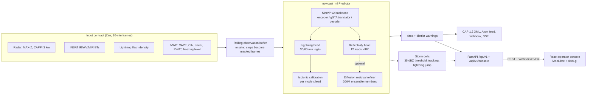

# Thunderstorm and lightning nowcasting (SIH 2026, PS 26072)

A 0-2 hour nowcasting system for thunderstorms and lightning, built for Smart India Hackathon 2026
problem statement 26072 (IMD). It takes a short history of radar, satellite, lightning and NWP
frames and produces:

- column-max reflectivity (dBZ) at 10-120 min leads, in 10-min steps
- calibrated P(at least one flash within 10 km) in the next 30 and 60 min
- a first-flash flag for cells that have not produced lightning yet
- storm cells with tracks, district-level warning levels and CAP 1.2 alerts, shown in an operator console

> **All results are on synthetic data.** No SEVIR training run, Indian radar/INSAT data or GPU was
> available while this was built. Every model in the repo was trained and evaluated on generated
> storms, and the skill page in the console shows those synthetic scores. They say nothing about
> real forecast skill. The SEVIR download/convert/train pipeline exists and was checked against the
> real file layout, but no real-data skill numbers exist yet.

## Architecture



| Directory | Package | What it is |
|---|---|---|
| [`ml/`](ml/README.md) | `nowcast_ml` | data contract, datasets, SimVP model, training stages, calibration, evaluation, export, `Predictor` |
| [`backend/`](backend/README.md) | `nowcast_backend` | ingest, rolling buffer, forecasts, storm cells, district/area warnings, CAP, HTTP API |
| [`web/`](web/README.md) | Vite + React 19 | operator console: map, warnings feed, skill page, system status |

The sub-READMEs are the detailed reference (full API tables, output contract, error codes, configs).
This page is the overview.

## The vision pipeline

### Inputs

Inputs follow a written data contract ([`ml/docs/data_contract.md`](ml/docs/data_contract.md),
checked by `nowcast-validate`). Channels are declared once in `ml/src/nowcast_ml/data/channels.py`,
each with a unit, a group (`radar`, `satellite`, `lightning`, `nwp`) and a valid physical range:

| Group | Channels |
|---|---|
| radar | `maxz`, `cappi3km` (dBZ) |
| satellite | INSAT TIR1, TIR2, WV, MIR brightness temperatures, TIR1 10-min cooling, TIR1-WV difference |
| lightning | flash density |
| nwp | CAPE, CIN, 0-6 km shear, PWAT, freezing level |

The model sees 7 input frames (70 min) and predicts 12 frames (120 min). The network input is the
normalized data concatenated with a per-channel availability mask, `(B, T_in, 2C, H, W)`, so
missing data is explicit rather than imputed.

### Model

`NowcastModel` (`ml/src/nowcast_ml/models/nowcast_model.py`) is one shared backbone with two heads:

- **Backbone: SimVP v2** (`models/simvp.py`), written from the paper/OpenSTL design using only
  static shapes and standard ops so it scripts with TorchScript and exports to ONNX. A per-frame
  strided ConvSC encoder, a gSTA translator (8 blocks, frames stacked on channels) and a
  PixelShuffle decoder with a skip connection. The full config (`configs/model/simvp.yaml`) is
  10.1 M parameters.
- **Reflectivity head**: decoder features of all input frames -> 12 normalized MAX-Z frames.
- **Lightning head**: takes the translator latent (storm dynamics), upsamples it with PixelShuffle
  and fuses it with the last input frame at full resolution (current flash density and
  availability masks) -> logits for the 30 and 60 min windows.

### Losses

| Output | Loss |
|---|---|
| reflectivity | intensity-weighted masked MSE: weight 2 at >= 20 dBZ, 5 at >= 35 dBZ, so convective cores are not averaged away |
| lightning | binary focal loss (alpha 0.25, gamma 2) for the heavily imbalanced flash/no-flash target |

### Degraded mode: radar modality dropout

Radar outages are a normal operating condition, so one checkpoint serves both full input and
satellite-only input. During training, `ModalityDropout` drops the whole radar group with
p = 0.3 per sample (`train.modality_dropout.p_radar`) by marking it unavailable; `model_input`
then zeroes the data, so the network sees exactly what a real outage looks like. At inference,
`detect_mode` picks `full` or `satellite_only` from radar coverage, and the mode is written into
every forecast's attributes. The demo scenario removes radar for the last hour to show this.

### Calibration

Lightning probabilities are calibrated with isotonic regression, one monotone curve per
(mode, lead), because full and satellite-only inputs produce differently calibrated raw scores.
Curves are fitted on the validation split (`nowcast-calibrate`) and stored as plain threshold
arrays applied with `np.interp`, so the artifact does not depend on the scikit-learn version.

### Ensembles: diffusion residual refiner (optional)

The deterministic forecast blurs with lead time. An optional stage trains a DDPM on the residual
`(y - det)` (cosine schedule, v-prediction), conditioned on the deterministic forecast and the
last input frame, with the backbone frozen. Members are sampled with deterministic DDIM (20
steps), so the same seed gives the same member. This follows the residual-diffusion idea from
CorrDiff. Measured cost at 256x256: 1.6 s/member on CPU, 0.37 s/member on Apple MPS.

### Training stages

| Stage | Config | What trains |
|---|---|---|
| (a) pretrain | `configs/train/pretrain_sevir.yaml` | SEVIR (VIL -> MAX-Z approximation, IR, GLM), 128x128, 7 -> 12 frames |
| (b) fine-tune | `configs/train/finetune_india.yaml` | India events; backbone frozen first, then unfrozen at lower LR |
| (c) lightning head | `configs/train/lightning_head.yaml` | only the lightning head (focal loss) |
| (d) calibration | `nowcast-calibrate` | isotonic curves per (mode, lead) |
| (e) ensemble | `configs/train/refiner.yaml` | diffusion refiner, base model frozen |

Splits are always by event, never by frame, and recorded in each artifact's `splits.json`.
`scripts/train_sevir_pipeline.sh` runs download -> convert -> stages a/c/d/e -> eval -> export,
resumable per stage. Working with the real SEVIR files surfaced three fixes now in the converter:
arrays are stored south-up, grids are LAEA-projected (geolocation uses the catalog `proj` string),
and repeated filler frames must be masked as missing.

### Evaluation

`nowcast-eval` scores the model (full), the model (satellite-only, radar forced off), the
optional ensemble and three baselines with the same code and the same output schema:

- persistence
- Lucas-Kanade optical-flow extrapolation
- 20-member pysteps STEPS ensemble

Metrics: CSI/POD/FAR at 20/35/45 dBZ per lead, FSS, Brier skill score vs climatology and vs
"lightning persists", reliability diagrams, ROC-AUC, first-flash hit rate / FAR / median lead
time, a power-spectrum sharpness ratio, CRPS and spread/skill for ensembles. Reports carry a
"SYNTHETIC DATA" banner when run on generated events.

### Serving

- **Artifact registry**: each model version holds weights, TorchScript, ONNX, config, channels,
  normalization stats, calibrator, splits, metrics, a model card and a SHA-256 manifest.
  Loading fails with `ModelLoadError` if any file is missing, modified or inconsistent.
- **Export parity**: `nowcast-export` writes TorchScript and ONNX (opset 17, dynamic H/W) and
  checks both against eager PyTorch (atol 1e-4) at two spatial sizes.
- **`Predictor`**: loaded once, stateless after load, returns an `xarray.Dataset` in a fixed
  output contract (`inference/schema.py`). The backend calls only this class.
- Measured forward pass, full-size model, 256x256: 607 ms CPU / 76 ms MPS (Apple M4 Pro).
  GPU timing has not been measured.

## Backend and console

The backend (FastAPI, ports-and-adapters layout) turns model output into operational products:

- **Ingest**: frames arrive by HTTP push (zipped Zarr), a watched directory or replay. Late or
  out-of-order frames are fine; missing 10-min steps become masked frames, and a forecast runs once
  at least 4 of the 7 input frames are real.
- **Storm cells**: connected areas >= 35 dBZ, tracked back through the inputs for motion,
  extrapolated 120 min with forecast intensity and lightning probability along the track,
  with flash rates and a 2-sigma lightning-jump test. Without radar, cells come from the +10 min
  forecast and are marked as forecast-based.
- **Warnings**: area warnings from lightning probability (0.3 / 0.5 / 0.7) and forecast MAX-Z
  (40 / 50 / 60 dBZ), superseded or cancelled run to run. District levels (yellow/orange/red) use
  probability, MAX-Z, lightning jumps in approaching cells and first-flash flags.
- **CAP 1.2** alerts with `status=Test` by default, an Atom feed, webhook and SSE events.
- **Console API** (`/api/v1/console`): returns exactly the response shapes defined in
  `web/src/data/types.ts`, plus a WebSocket `/live` tick for each new forecast.

The console (React 19, MapLibre, deck.gl, TanStack Query, Zod, Zustand) shows observed and
forecast radar, lightning, cell tracks and district warnings on a time slider with replay,
a warnings feed with CAP export, the evaluation skill page and per-input system status. It
reads everything through one `DataSource` interface: `api` (the backend) or `mock` (procedural
scenario, no backend).

## Run it: `make demo`

Requirements: Python 3.11, [uv](https://github.com/astral-sh/uv), Node.js. On macOS, `pysteps`
needs `brew install libomp` (handled by `ml/Makefile`).

```bash
make -C ml venv      # creates ml/.venv with Python 3.11 (uv)
make install         # ml + backend into ml/.venv, npm install in web/
make demo            # backend on :8000, console on http://localhost:5173
```

On the first run the backend (`backend/src/nowcast_backend/demo.py`) builds everything under
`backend/var/demo/`:

1. 24 synthetic storm events,
2. a small model trained, calibrated and evaluated against the baselines on them
   (about 90 s to 2 min on a laptop CPU; reused on later runs),
3. one synthetic pre-monsoon afternoon over Odisha (09:00-12:30 UTC on a ~2 km grid) with radar
   lost from 11:30 to show the satellite-only fallback, replayed through the normal ingest path.

Then open <http://localhost:5173>. API docs are at <http://127.0.0.1:8000/api/v1/docs>.
Ctrl-C stops both processes.

Other targets:

```bash
make test            # ml + backend test suites, type-check the console
make lint
make -C ml e2e       # synthetic data -> train -> calibrate -> eval -> export -> predict (~30 s CPU)
make -C ml e2e-ensemble   # adds the refiner stage and a 5-member ensemble forecast
```

To run with a real model: produce input-contract stores, train with the stages above, then
`NOWCAST_MODEL_PATH=<artifact>/latest nowcast-backend serve` and push frames
(see [`backend/README.md`](backend/README.md)). Configuration is via `NOWCAST_*` variables;
see [`backend/.env.example`](backend/.env.example). The console needs no change.

## Tests

The ML suite (`ml/tests`) covers schema validation fixtures, hand-computed metric values,
baseline advection direction, a one-batch overfit check, registry round-trip and tamper
detection, TorchScript/ONNX parity, `Predictor` in both modes, a refiner that must learn a known
residual, CLI smoke tests, and execution of the README's backend example. The backend suite runs
against a fake engine, with `make -C backend test-all` also training a tiny model and running
the real `Predictor`. Everything runs offline on CPU.

## Team and my contributions

Team project for SIH 2026. Of the 17 commits, 16 are mine (Aadvik Chaturvedi). The console's
initial build (components, map, warnings feed, skill and status pages, mock data source) was
written by Sahil Makhijani.

What I built:

- the whole `ml/` package, milestone by milestone (M0-M9): data contract and datasets, SimVP
  backbone and heads, losses, modality dropout, lightning-head stage and isotonic calibration,
  evaluation suite and baselines, registry/export/`Predictor`, diffusion refiner, and the SEVIR
  real-data fixes and pipeline script
- the whole `backend/`: ingest, cells, warnings, CAP, API, console API, demo
- integration of the console with the backend: the `api` data source, timeline from the
  backend, WebSocket live updates, and the console-shaped endpoints and their tests

## Limitations and next steps

- **No real-data skill.** All training, calibration and evaluation so far is on synthetic storms.
  The next step is running `scripts/train_sevir_pipeline.sh` on a GPU, then fine-tuning on Indian
  radar/INSAT events once they are available in the data contract.
- SEVIR VIL -> dBZ is an approximate inversion; India fine-tuning is expected to correct intensity.
- Whether refiner ensemble spread is well calibrated can only be judged on real data.
- Warning thresholds are starting values, not verified ones, which is why CAP output defaults to
  `status=Test`.
- No parsers for raw radar / INSAT / lightning-network files; the data team is expected to write
  contract-format stores (`backend/.../adapters/sources.py` is the plug-in point).
- Single-process backend (in-memory buffer, serialized inference). District boundaries are
  community GeoJSON, not official Survey of India / IMD shapefiles.
